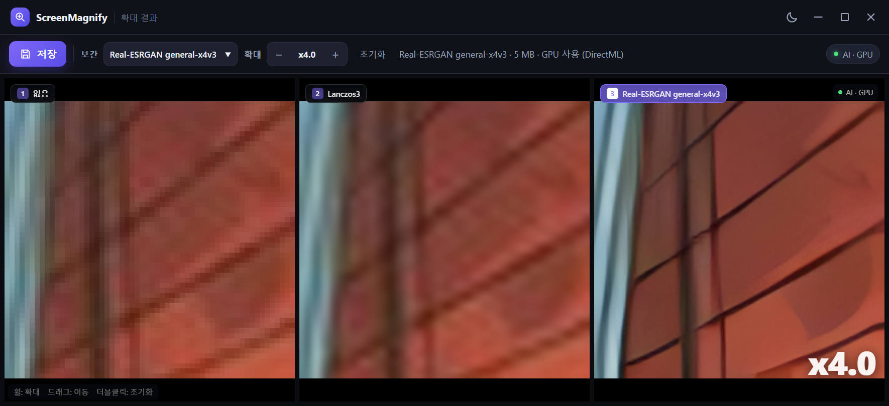
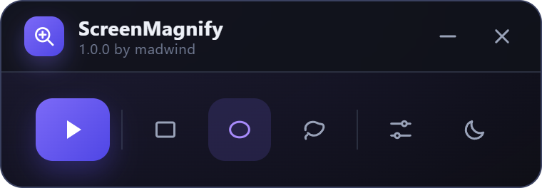
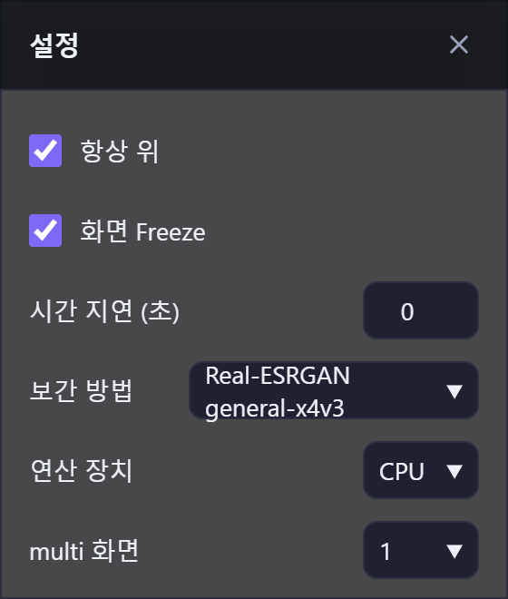
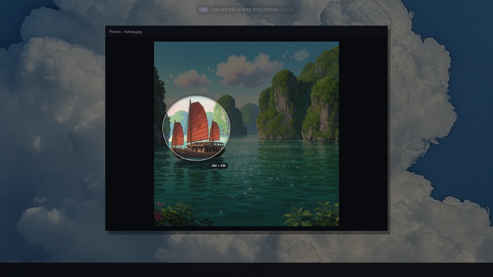
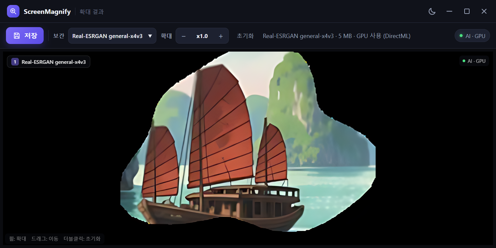

# ScreenMagnify

ScreenMagnify is a small Windows tool that magnifies any part of your screen. Drag a rectangle, an ellipse or a freehand shape, and the selection opens in a result window where you can zoom up to **x64** and compare up to three scaling methods side by side, from plain pixels and classic filters to **AI upscalers** (Real-ESRGAN, 4xNomosUni). Everything runs on your PC; nothing is uploaded.

<p align="center">
  
</p>

<p align="center">
  
  
</p>

The app text is Korean. The screenshots show a fake desktop (a sky wallpaper and a picture viewer), made by `scripts/capture-docs.cjs`.

## Features

- **Three ways to select.** Rectangle, ellipse or freehand. Hold **Shift** while dragging a rectangle or an ellipse for a 1:1 shape. **Esc** cancels.
- **A still picture.** The screen is captured once when the result opens, and only the selected region (and its shape) is kept. Nothing outside the selection can be reached by panning or zooming out.
- **Zoom x0.5 to x64.** Mouse wheel zooms around the pointer, drag pans, double-click resets. Steps are 0.5 up to x4, then 1, 2, 4 and 8 as you go higher. Zooming out below x1 shrinks the picture inside the window; the original aspect ratio is always kept.
- **Up to three panels.** Show the same region with different methods next to each other; click a panel to make it the active one (the one that is saved, and the one the AI works on).
- **Methods.** None (nearest neighbour), Bilinear, Bicubic (Catmull-Rom), Lanczos3, NIS (NVIDIA Image Scaling) and three AI models run through ONNX Runtime:
  - **Real-ESRGAN general-x4v3** (4.9 MB, the default): sharp text and pictures, fast even on the CPU.
  - **4xNomosUni SPAN** (1.6 MB): the smallest and fastest.
  - **Real-ESRGAN x4plus** (64 MB): very good on pictures, but small text can break and it is slow on the CPU.
- **CPU or GPU.** One switch in the settings (or the AI badge in the result window): on **GPU** the filters run as WebGL shaders and the AI uses DirectML; on **CPU** the filters are resampled in JavaScript and the AI runs on the CPU. NIS needs the GPU and is disabled on CPU.
- **Save as PNG.** The saved picture is exactly what the active panel shows; everything outside an ellipse or freehand shape (and outside the picture when zoomed out) is transparent.
- **Settings in their own window.** Always on top, screen freeze while selecting, delay (0 to 10 s), default method, device, number of panels (1 to 3). Dark and light themes.

<p align="center">
  
  
</p>

## Install

No installer. Download `ScreenMagnify-<version>.zip` from the [Releases](https://github.com/madwind0526/ScreenMagnify/releases) page, unzip it anywhere you can write to (not `Program Files`) and run `ScreenMagnify\ScreenMagnify.exe`. The app is **not code-signed**, so Windows SmartScreen may warn you; choose "More info" and then "Run anyway".

Windows 10 or 11 (64-bit). A GPU with DirectX 12 is only needed for the GPU option.

## Use

1. Press the play button (or **Ctrl+Enter**) and drag over the part of the screen you want.
2. In the result window, scroll to zoom, drag to pan, and pick a method from the list at the top. Click the save button (or **Ctrl+S**) to write a PNG.
3. Keys in the result window: `+` and `-` zoom, `0` resets, arrow keys pan.

## Build from source

```bash
npm install
npm start            # run in Electron
npm run check        # syntax-check every script
npm run dist         # release/ScreenMagnify-<version>.zip (unpacked folder, unsigned)
npm run screenshots  # store/cutouts/*.png from the real windows (needs a desktop)
python scripts/store-mockup.py   # compose the store images in store/promo
```

The AI models are ONNX files in `models/` (input `input`, 1x3xHxW, float 0..1; output 4x larger): `realesr-general-x4v3.onnx`, `4xNomosUni_span_multijpg_fp32_opset17.onnx` and `realesrgan_x4plus.onnx`. They are in the repository and in the release zip. To add another x4 model, put its ONNX file there and register it in `AI_MODELS` (`electron/main.js`) and `public/js/methods.js`.

When launching Electron from a shell that runs under Claude Code or VS Code, unset `ELECTRON_RUN_AS_NODE` first.

## Project layout

| Path | What |
|---|---|
| `electron/main.js` | main process: windows, settings file, selection overlays, freeze capture, save and folder IPC, AI worker control |
| `electron/ai-worker.js` | AI inference in a worker thread (ONNX Runtime, DirectML or CPU) |
| `electron/preload.js` | the `window.api` bridge |
| `public/index.html`, `js/main.js` | the main window (one row of icons) |
| `public/settings.html`, `js/settings.js` | the settings window |
| `public/overlay.html`, `js/overlay.js` | the selection overlay |
| `public/result.html`, `js/result.js` | the result window: capture, view maths, panels, save dialog |
| `public/js/upscaler.js` | WebGL2 shaders: Bilinear, Bicubic, Lanczos3, NIS |
| `public/js/cpu-scaler.js` | CPU resamplers (nearest, bilinear, bicubic, Lanczos3) |
| `public/js/methods.js` | the list of methods |
| `scripts/` | zip, screenshot and store-image scripts, syntax check |
| `codereview.md` | the latest code review and what was done about it |

## Credits

- [Real-ESRGAN](https://github.com/xinntao/Real-ESRGAN) by Xintao Wang et al. (BSD-3-Clause): `realesr-general-x4v3` and `RealESRGAN_x4plus`.
- `4xNomosUni_span_multijpg` by Philip Hofmann ([Phhofm/models](https://github.com/Phhofm/models), CC-BY-4.0), found through [OpenModelDB](https://openmodeldb.info/).
- [ONNX Runtime](https://onnxruntime.ai/) runs the models.
- [NVIDIA Image Scaling](https://github.com/NVIDIAGameWorks/NVIDIAImageScaling) coefficients (MIT) in `public/js/nis-coefs.js`.
- [Electron](https://www.electronjs.org/).

MIT licensed (see `LICENSE`); each model keeps its own license.
